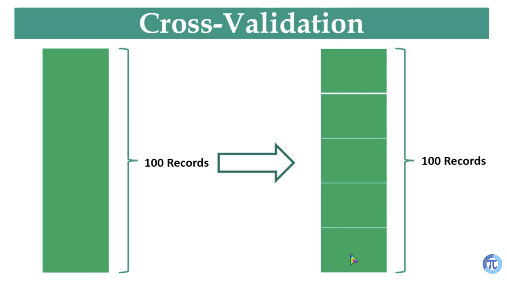
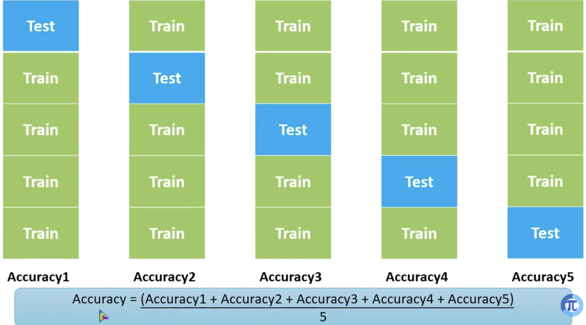

# Cross Validation

With this we can find what is the best ML algorythm for specific data set

 

We divide the data set into subsets.

After that we use one set to train and other subsets to test

likewise we recursively do this process to every subset until it gets tested

We have to do this for every algorythm

 

 

We get heighest accuracy score algorythm to train the model

 

## Example

[Example](../../python/cross-validation/cross-validation.ipynb)
