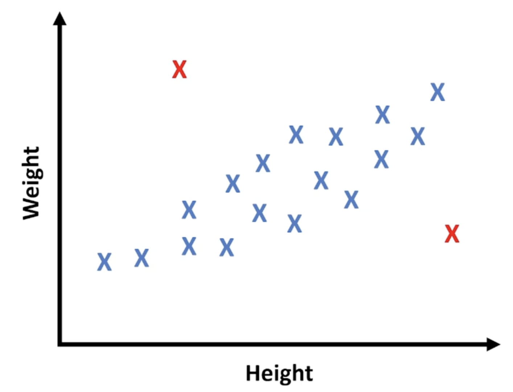
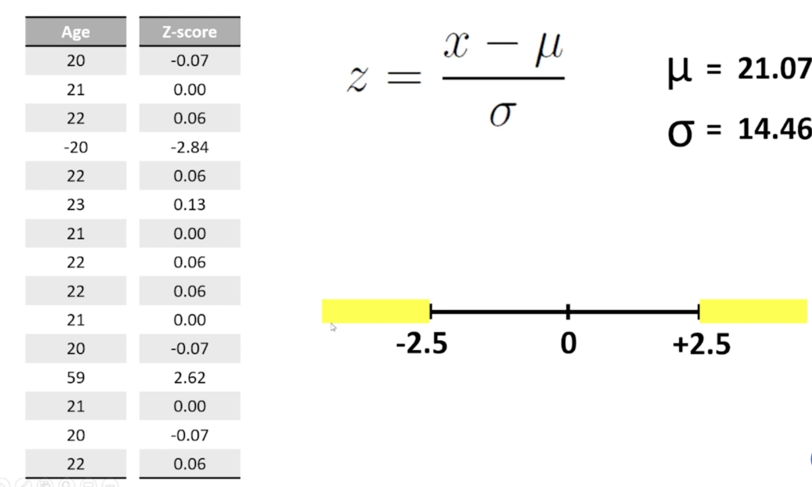
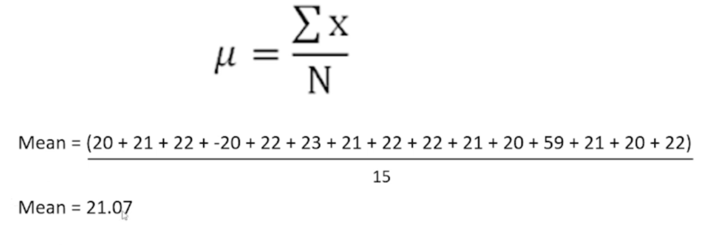
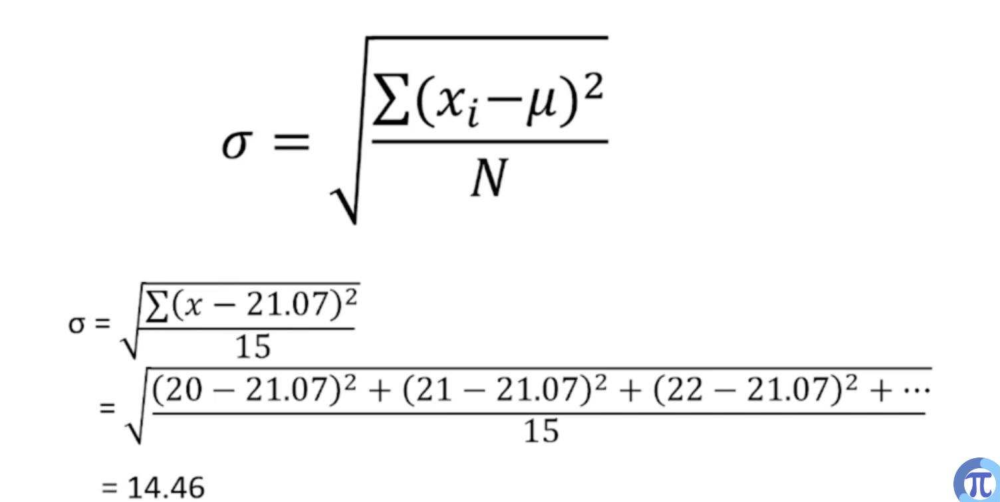
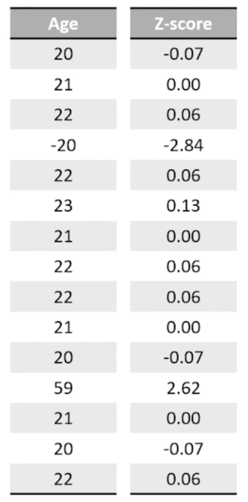

# Outlier Detection

If our data set has unusual abnormal data, we can identify those things as `Outliers`

We can remove those things as well

For every row value we have to calculate `z score`

 

 

 

After calculate the z scores, We have to give a threshhold value (2.5 according to this). We get the z score values inside of that threshold. Others are outliers and we drop those data points

