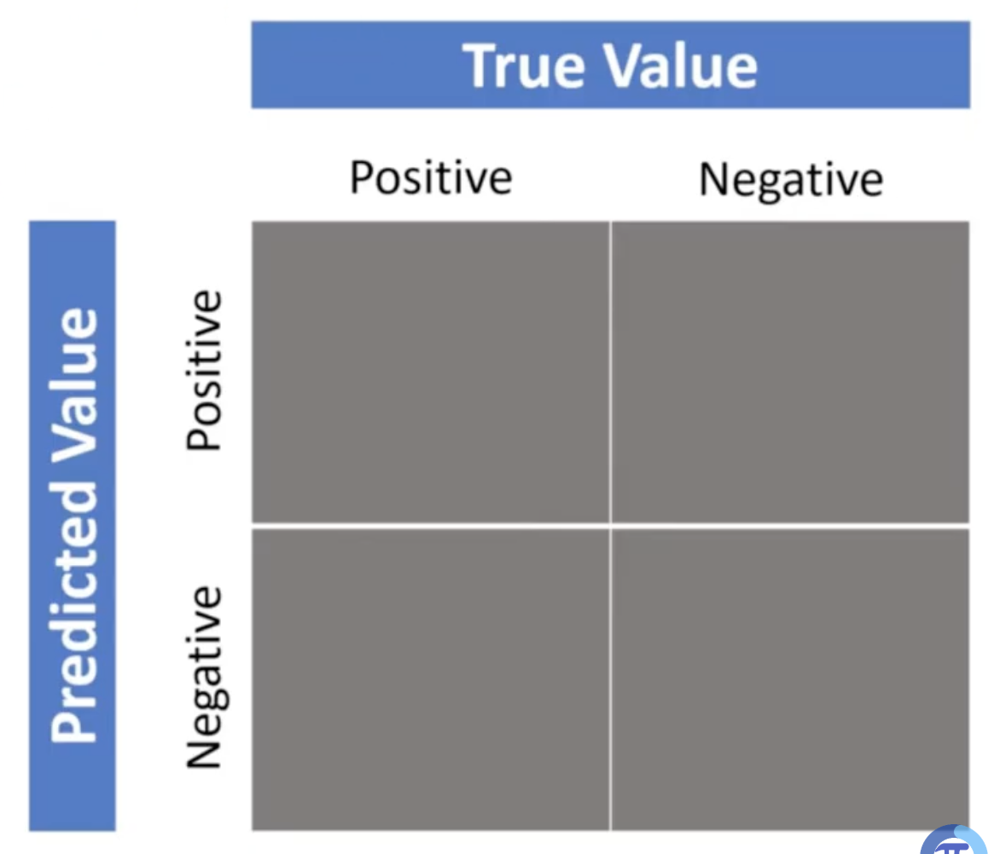
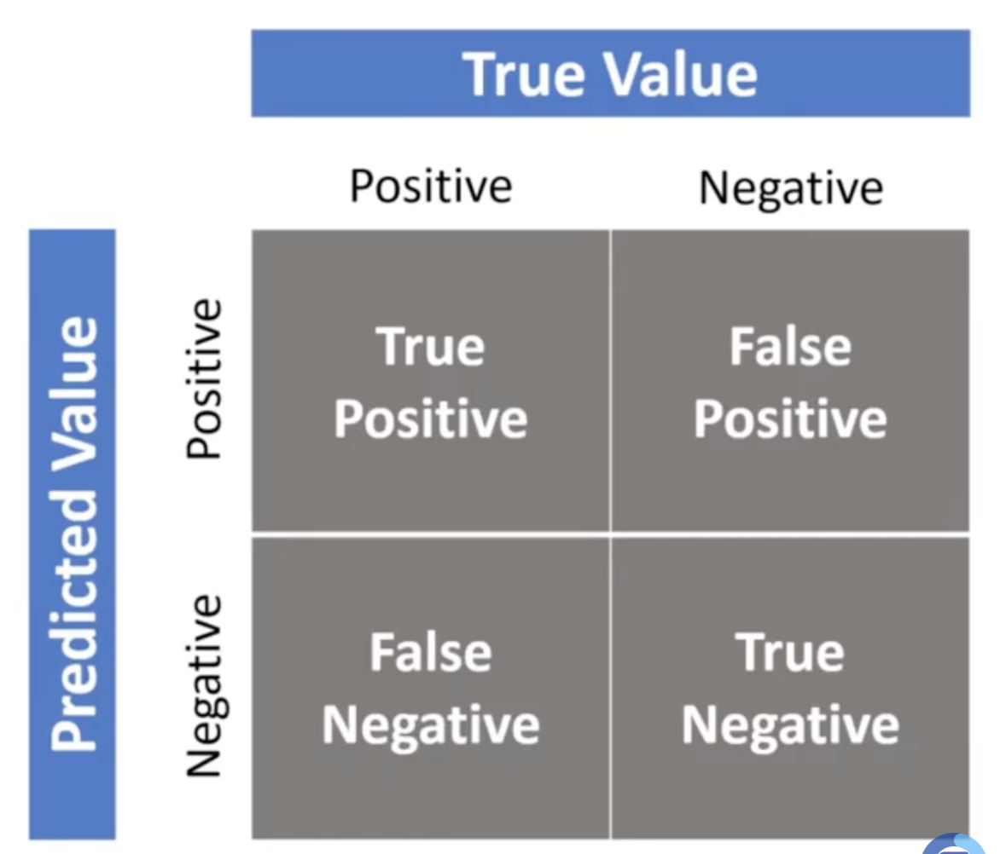
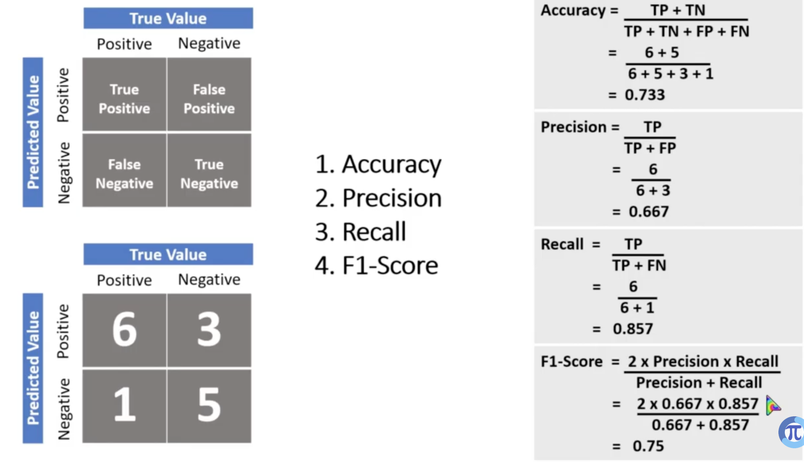

# Confusion Matrix

With confusion matrix we can calulate 4 things
- Accuracy
- Precision
- Recall
- F1-Score

 

• **True Positives (TP)** - The model correctly predicted the positive class.
• **True Negatives (TN)** - The model correctly predicted the negative class.
• **False Positives (FP)** - The model predicted positive, but the actual label was negative.
• **False Negatives (FN)** - The model predicted negative, but the actual label was positive.

 

## Accuracy Score

\(\text{Accuracy}=\frac{\text{True\ Positives\ (TP)}+\text{True\ Negatives\ (TN)}}{\text{TP}+\text{TN}+\text{False\ Positives\ (FP)}+\text{False\ Negatives\ (FN)}}\)

 

## Precision

**Precision (Quality of Positive Predictions).** 
Precision measures what proportion of positive identifications was actually correct.
\(\text{Precision}=\frac{\text{True\ Positives\ (TP)}}{\text{TP}+\text{False\ Positives\ (FP)}}\)

 

## Recall

**Recall (Quantity of Positives Found).** Recall, also known as sensitivity, measures what proportion of actual positives was identified correctly.

\(\text{Recall}=\frac{\text{True\ Positives\ (TP)}}{\text{TP}+\text{False\ Negatives\ (FN)}}\)

 

## F1 Score

**F1-Score (Balance Between Both).** 
The F1-Score is the harmonic mean of precision and recall, giving you a single score that balances both concerns.

\(\text{F1-Score}=2\times \frac{\text{Precision}\times \text{Recall}}{\text{Precision}+\text{Recall}}\)

 

## Example

