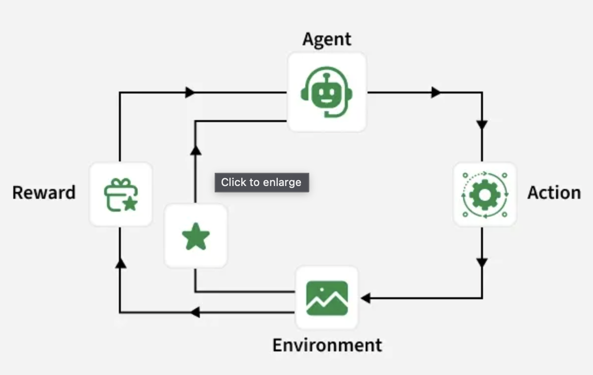
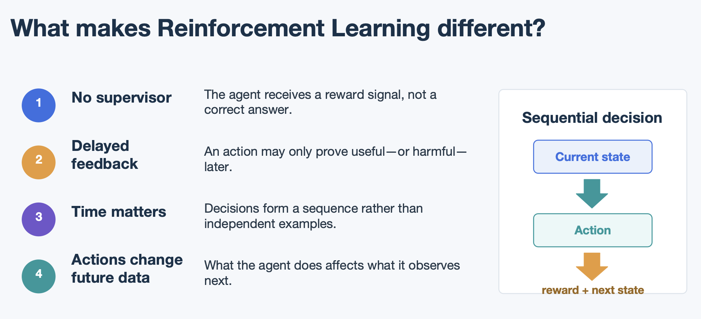
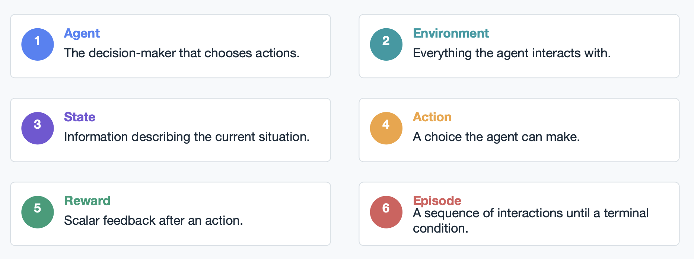
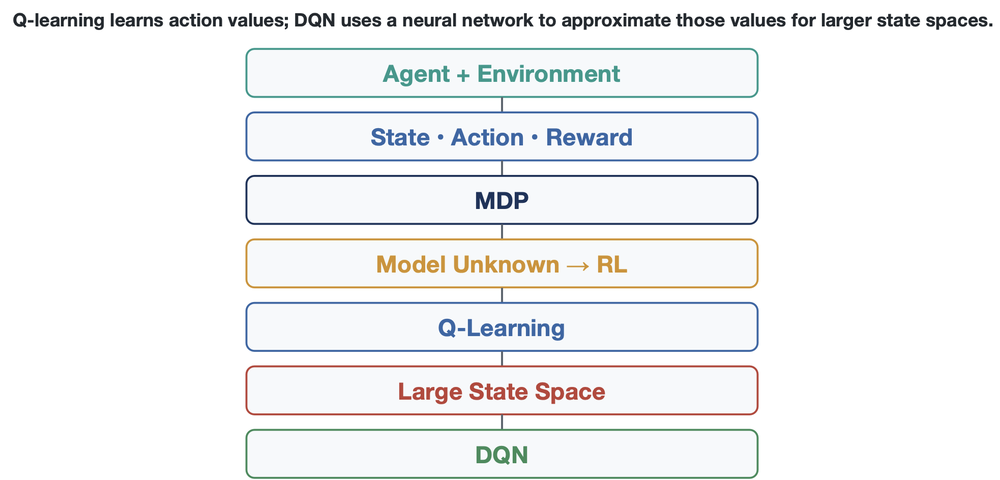
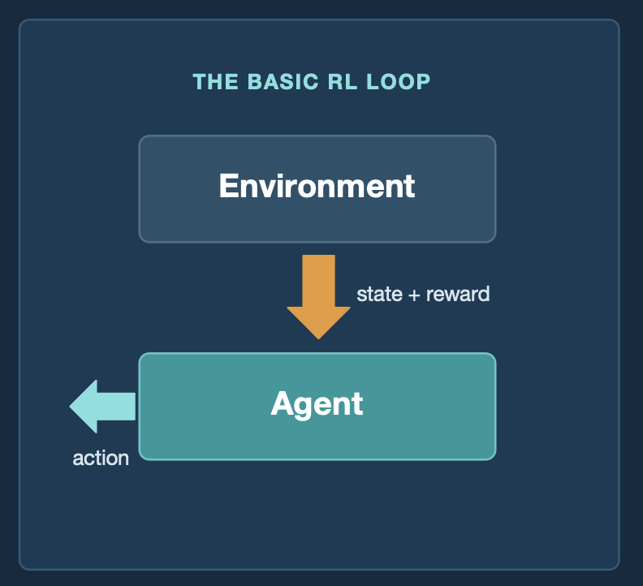
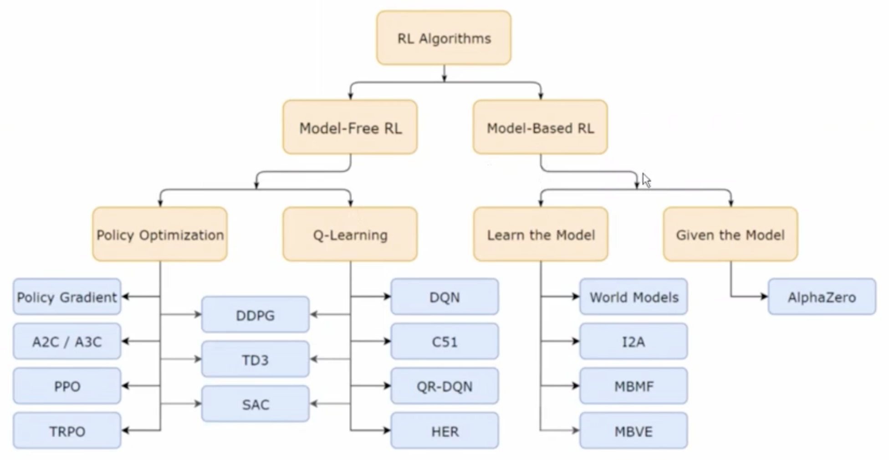
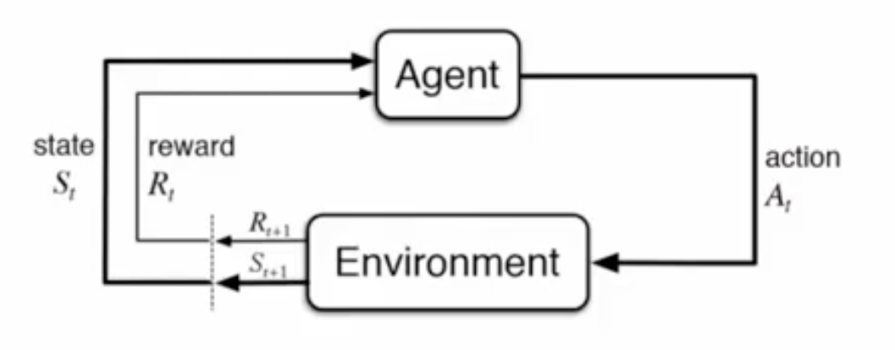
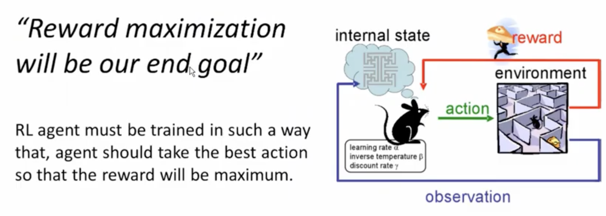

# Reinforcement Learning

The model learns by `interacting with an environment` through a system of trial and error

 

Terminology

 

**RL Loop**:

 

**Mechanism**:
It receives positive rewards for correct moves and penalties for mistakes. It aims to maximize its overall cumulative reward.

**Example**:
Training autonomous self-driving cars or teaching AI agents how to master chess and video games.

**Common Algorithms**:

- [Q-Learning](../rl/ql.md)
- [Deep Q-Networks (DQN)]() 
- [Actor-Critic]()

---

| Reinforcement Learning Method | Core Strategy | Core Objective | Key Algorithms | Best Applied To |
| :--- | :--- | :--- | :--- | :--- |
| **Model-Free (Value-Based)** | Estimates the long-term expected reward for every possible action. | Find the highest-paying choice. | • Q-Learning • DQN (Deep Q-Network) • SARSA | Environments with distinct, countable choices (e.g., retro video games, grid navigation). |
| **Model-Free (Policy-Based)** | Directly optimizes the action probabilities without scoring choices first. | Master the optimal behavior rulebook. | • Policy Gradient • REINFORCE | Environments with fluid, continuous actions (e.g., robotic joints, autonomous steering). |
| **Model-Free (Actor-Critic Hybrid)**| Merges both worlds: one network acts, while the other network critiques the action. | Balance learning stability and speed. | • PPO (Proximal Policy Optimization) • A2C / A3C • TRPO | High-stakes, complex optimization problems (e.g., aligning Large Language Models via RLHF). |
| **Model-Based** | Builds an internal mental simulation to predict environmental changes. | Plan ahead by forecasting outcomes. | • AlphaZero / MuZero • Dyna-Q • MBPO | Complex strategy tasks where real-world mistakes are too costly (e.g., Chess, Go, industrial automation). |

 

## How Works

Reinforcement Learning works on `Markov Decision Process`

Mainly should identify `Action`, `State` and `Reward`

 