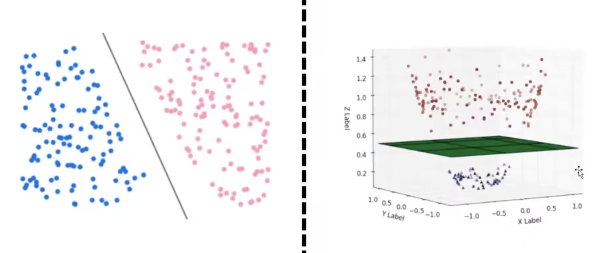
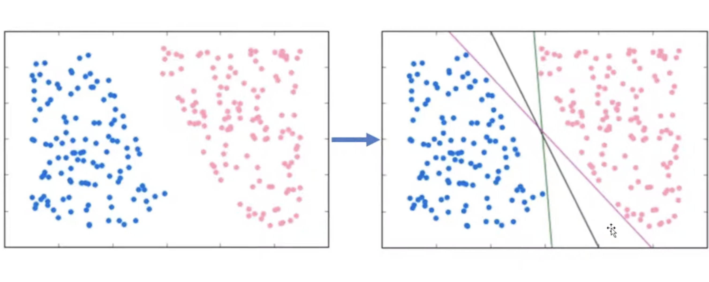
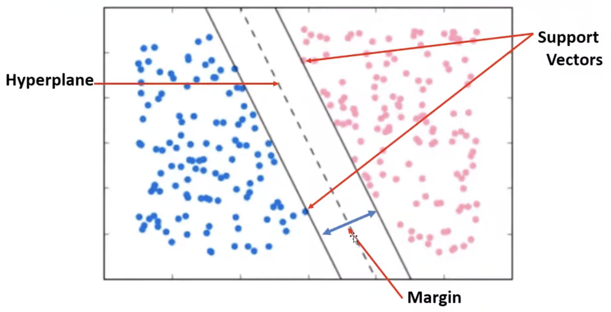
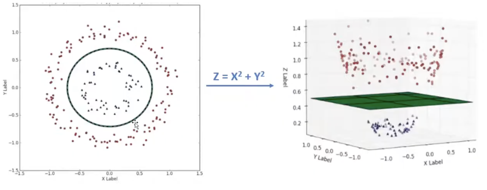
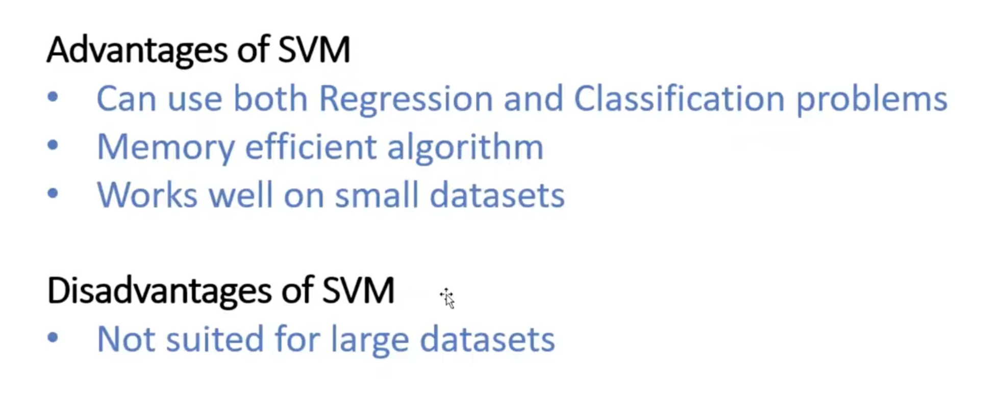
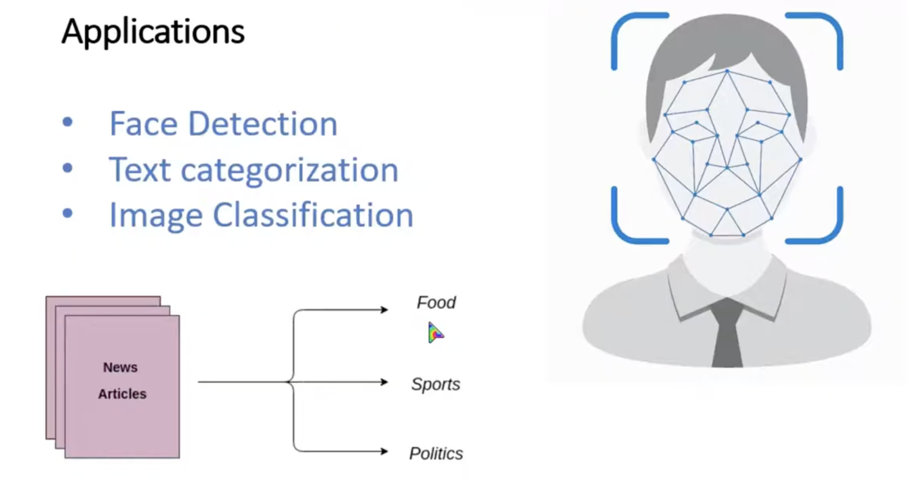

# Support Vector Machine

`A Support Vector Machine (SVM)` is a supervised machine learning algorithm used mostly for classification tasks and sometimes for regression

It works by finding a decision boundary, called a hyperplane, that best splits data points into different groups or classes

We select this model type:

**If we need to maximize the separation between classes, work with high-dimensional spaces, or deal with limited training data**

 

 

## Pros and Cons

 

## Usage

