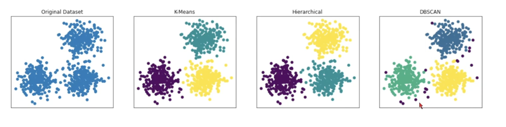
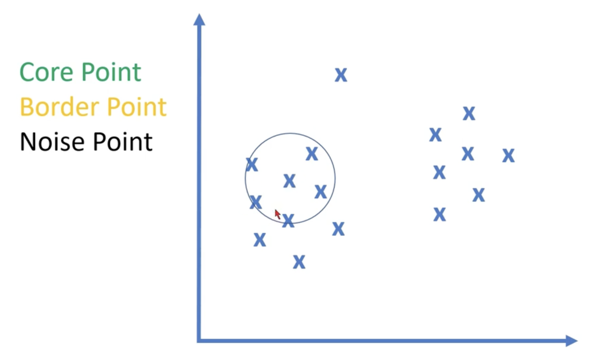
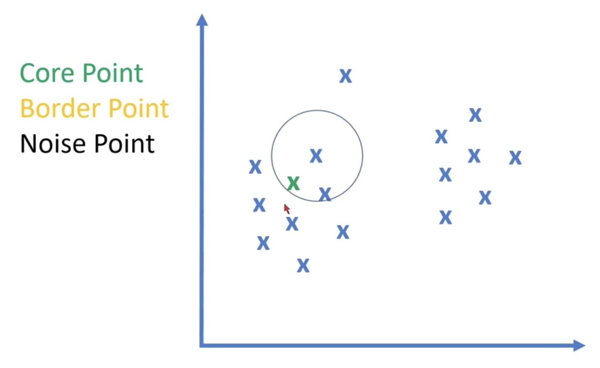
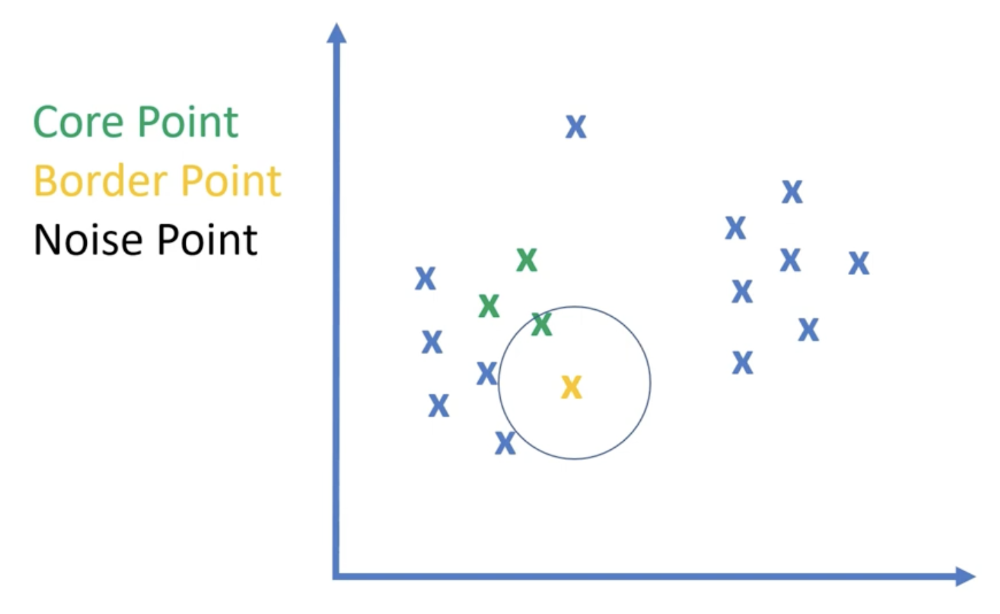

# DBSCAN Clustering

`Density-Based Clustering` is an unsupervised machine learning method that groups data points together based on how closely packed they are in space.

- It can identify noices in clusters

 

## How It Works

- Core Point - Have MinPoints or More than
- Border Point - Have Less than MinPoints
- Noise Point - No Points

 

EPS = 2 (Circle Radius Value) / (Epsilon Value)
MinPoints = 3

That's how they cluster data points
